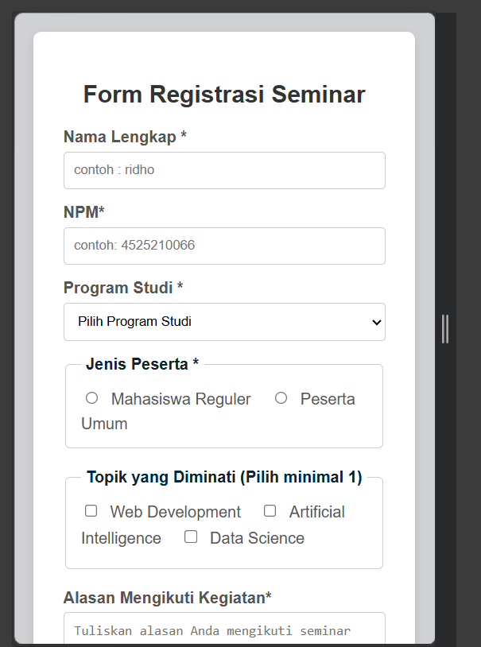
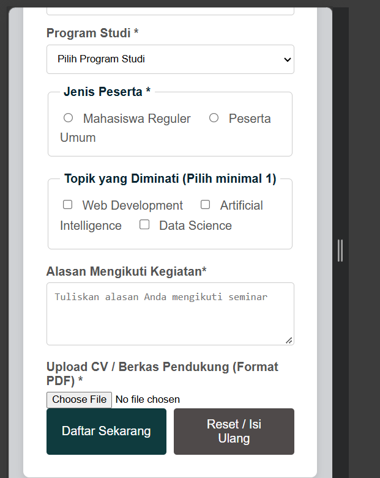

# LAPORAN PRAKTIKUM DESAIN WEB

## Identitas

| Data         | Keterangan                          |
| ------------- | ----------------------------------- |
| Nama         | Ridho Sachlan                       |
| NPM           | 4525210066                          |
| Kelas         | A                                   |
| Program Studi | Teknik Informatika                  |
| Mata Kuliah   | Prak. Desain Web                    |

---

## Fitur & Komponen HTML Form

1. **Komponen Form Lanjutan**:
   - `text`: Input untuk Nama Lengkap dan NIM / Nomor Identitas.
   - `select`: Elemen dropdown untuk memilih Program Studi.
   - `radio`: Pilihan eksklusif jenis peserta (Mahasiswa Reguler dan Peserta Umum) menggunakan `<fieldset>` dan `<legend>`.
   - `checkbox`: Pilihan jamak (multiple) untuk topik seminar yang diminati.
   - `textarea`: Kolom teks multi-baris untuk mengisi alasan mengikuti kegiatan.
   - `file`: Tombol unggah dokumen pendukung (CV) dengan batasan format file PDF.

2. **Tombol Aksi**:
   - `type="submit"` (`btn-submit`): Mengirimkan data form pendaftaran ke server.
   - `type="reset"` (`btn-reset`): Mengosongkan dan mereset seluruh isian form kembali ke kondisi awal.

3. **Aturan Validasi HTML5**:
   - `required`: Mewajibkan kolom diisi sebelum form dikirim.
   - `minlength` & `maxlength`: Menentukan batas minimal dan maksimal jumlah karakter pada input teks dan textarea.
   - `pattern`: Menentukan pola regular expression (misalnya `[0-9]{10}` untuk validasi tepat 10 digit angka pada NIM).
   - `accept`: Membatasi ekstensi file yang diizinkan (yaitu `.pdf`).

4. **Aksesibilitas & Backend Readiness**:
   - Setiap elemen `<label>` terhubung langsung ke kontrol input menggunakan pasangan atribut `for` dan `id`.
   - Menggunakan `method="POST"` dan `enctype="multipart/form-data"` untuk pengiriman data serta berkas lampiran dengan aman.


## Ringkasan 

> **Ringkasan Perubahan, Masalah, dan Solusi**
>
> Pada praktikum ini, dilakukan pembangunan form registrasi event seminar IT lanjutan yang mencakup elemen-elemen pilihan, unggah berkas, area teks, serta penerapan minimal empat aturan validasi HTML5. Perubahan utama meliputi integrasi elemen form lanjutan seperti radio button, checkbox group, select dropdown, textarea, serta file upload, dilengkapi tombol reset untuk memudahkan pengguna mengulang pengisian data.
>
> Masalah yang ditemui selama pengerjaan adalah ketidaksesuaian format input NIM yang sempat lolos sebelum divalidasi serta kebutuhan penataan layout tombol aksi agar berdampingan rapi dengan CSS terpisah. Solusinya adalah menerapkan atribut validasi yang ketat seperti `pattern="[0-9]{10}"` untuk NIM, menyusun flexbox pada grup tombol, serta memastikan struktur HTML dan file `style.css` terpisah dengan baik agar tata letak responsif di berbagai perangkat. Penggunaan `method="POST"` dipilih untuk mengamankan pengiriman data formulir ke backend.


---

## Struktur Folder

```text
Pertemuan8/
├── css/
│   └── style.css
├── img/
│   ├── desktop.png
│   ├── mobile1.png
│   └── mobile2.png
├── index.html
└── README.md
```

## Bukti Pengerjaan

- **Tampilan Desktop:** 
- **Tampilan Mobile:**
- 
- 